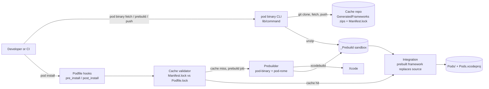

<div align="center">

# 🛠️ cocoapods-binary-cache

**Cuts Xcode build time with prebuilt pods shared via git · fetch · prebuild · push · viz**

This repo is Glovo's fork of [`grab/cocoapods-binary-cache`](https://github.com/grab/cocoapods-binary-cache). It is a Ruby gem that CocoaPods loads as a plugin. The plugin prebuilds selected pods into frameworks, stores them in a git **cache repo**, and lets other machines reuse them instead of compiling the sources. It is not a service and nothing deploys it: projects add it to their `Gemfile` as a Git-sourced gem.

[](.github/workflows/test.yml)
[](cocoapods-binary-cache.gemspec)
[](VERSION)
<br/>
[](#testing)
[](LICENSE)
[](https://github.com/grab/cocoapods-binary-cache)

</div>

---

## Table of contents

- [Overview](#overview)
- [Architecture](#architecture)
- [Adding binary cache to a project](#adding-binary-cache-to-a-project)
- [Build & local development](#build--local-development)
- [Testing](#testing)
- [Code quality](#code-quality)
- [CI/CD](#cicd)
- [Repository layout](#repository-layout)
- [Contributing & conventions](#contributing--conventions)
- [Glossary](#glossary)
- [Ownership & support](#ownership--support)

---

## Overview

Xcode projects that use CocoaPods compile every pod from source after a clean build. This plugin removes that cost for pods you mark with `:binary => true`. A **prebuild job** compiles those pods into frameworks (or xcframeworks), zips them and commits them to a cache repo. On every other machine, `pod binary fetch` pulls the zips. During `pod install` the plugin compares the cached `Manifest.lock` with `Podfile.lock`. Pods whose versions match (**cache hit**) are integrated as prebuilt frameworks. Everything else is integrated from source as usual.

**Glovo fork.** On 2026-10-29 the fork was 2 commits ahead of and 0 behind `grab/cocoapods-binary-cache` `master`. The one Glovo change ([`9ab9d57`](https://github.com/Glovo/cocoapods-binary-cache/commit/9ab9d579589fc9c372ea3de5529e0f6f400d8283), 2024-12-11) relaxes the `xcpretty` dependency in the [gemspec](cocoapods-binary-cache.gemspec) from `~> 0.3.0` to `~> 0.3`. Everything else is upstream code at version `0.1.14` ([`VERSION`](VERSION)).

| | |
|---|---|
| Language / build | Ruby gem ([`cocoapods-binary-cache.gemspec`](cocoapods-binary-cache.gemspec)) · Bundler |
| Runtime | Loaded by CocoaPods via `plugin "cocoapods-binary-cache"` in a Podfile · adds the `pod binary` commands |
| Storage | A git cache repo you own, or a local directory when no `remote` is set |
| Runtime dependencies | `cocoapods >= 1.5.0` · `fourflusher ~> 2.0` · `rgl ~> 0.5.6` · `xcpretty ~> 0.3` · `parallel ~> 1.0` |
| Owner | Not declared: no `CODEOWNERS` or `catalog-info.yaml` (see [Ownership & support](#ownership--support)) |

<details><summary><b>Benchmark (upstream measurements)</b></summary>

Upstream built a project to measure the gain. The demo project ([`PodBinaryCacheExample/`](PodBinaryCacheExample)) uses these pods:

```
AFNetworking
SDWebImage
Alamofire
MBProgressHUD
Masonry
SwiftyJSON
SVProgressHUD
MJRefresh
CocoaLumberjack
Realm
SnapKit
Kingfisher
```

The recorded result:


Hardware used for that benchmark:

```
MacBook Pro (15-inch, 2018)
Mac OS 10.14.6
Processor 2.6 GHz Intel Core i7
Memory 16 GB 2400 MHz DDR4
```

To try it on your machine:

```bash
cd PodBinaryCacheExample
sh BuildBenchMark.sh             # builds once without the cache, once with it, and prints both times
```

> [!WARNING]
> [`BuildBenchMark.sh`](PodBinaryCacheExample/BuildBenchMark.sh) and [`rebuild.sh`](PodBinaryCacheExample/rebuild.sh) still call the old `pod binary-cache --cmd=fetch` syntax. The current CLI ([`lib/command/`](lib/command)) only defines `pod binary fetch`, so change that line before you run them.

In upstream's real project, about 15% of the Swift/ObjC code came from vendor pods. With this plugin they saw build time drop by about 10%:


</details>

---

## Architecture

The gem has two entry points: the `pod binary` CLI, which moves the cache, and the Podfile hooks, which decide per pod whether to use the prebuilt framework.



`pod binary prebuild` fetches the cache, runs a pod install in a separate `_Prebuild` sandbox, and builds the missed pods with `xcodebuild`. It then writes the changed pods to `_Prebuild_delta/changes.json`, zips them into the cache directory and, with `--push`, commits `Update prebuilt cache` and pushes the cache branch. A normal `pod install` only reads the sandbox. Upstream's hand-drawn flow is in [`docs/resources/pods_cache_flow.png`](docs/resources/pods_cache_flow.png), explained in [`docs/how_it_works.md`](docs/how_it_works.md).

---

## Adding binary cache to a project

Requirements from the upstream README: **Ruby >= 2.4** and **CocoaPods >= 1.5.0**.

1. Create a git repo to store the prebuilt frameworks. It must work with `git clone` and `git fetch` from every machine that uses it.
2. Add the gem to the project's `Gemfile` and run `bundle install`:
   ```rb
   gem "cocoapods-binary-cache", :git => "https://github.com/Glovo/cocoapods-binary-cache.git"
   ```
   If you're new to [Bundler](https://bundler.io/), see [this setup guide](https://www.mokacoding.com/blog/ruby-for-ios-developers-bundler/).
3. Load the plugin at the **beginning** of the Podfile:
   ```rb
   plugin "cocoapods-binary-cache"
   ```
4. Configure it (all options are listed below and in [`docs/configure_cocoapods_binary_cache.md`](docs/configure_cocoapods_binary_cache.md)):
   ```rb
   config_cocoapods_binary_cache(
     cache_repo: {
       "default" => {
         "remote" => "git@cache_repo.git",
         "local" => "~/.cocoapods-binary-cache/prebuilt-frameworks"
       }
     },
     prebuild_config: "Debug"
   )
   ```
5. Mark pods as prebuilt (also called **binary pods**):
   ```rb
   pod "Alamofire", "5.2.1", :binary => true
   ```
   Dependencies of a prebuilt pod are treated as prebuilt too. For example, if `RxCocoa` has `:binary => true`, `RxSwift` is prebuilt as well.
6. Fill the cache from a prebuild job, usually on CI:
   ```bash
   bundle exec pod binary prebuild --push        # fetch, build cache misses, push the cache
   ```
7. Everyday use on any machine:
   ```bash
   bundle exec pod binary fetch                  # pull and unzip the cache
   bundle exec pod install
   ```

More usage patterns were meant to go in [`docs/best_practices.md`](docs/best_practices.md), which is still marked "under construction".

> [!WARNING]
> `PodBinaryCacheConfig.json` is **deprecated**. When `cache_repo` isn't set in `config_cocoapods_binary_cache`, [`lib/command/config.rb`](lib/command/config.rb) falls back to that file and prints a deprecation warning. Declare `cache_repo` in the Podfile instead.

### Known issues

- **Exporting an IPA with Bitcode:** turn off the _rebuild from bitcode_ option. See [grab/cocoapods-binary-cache#24](https://github.com/grab/cocoapods-binary-cache/issues/24).
- **Header-only pods:** pods with empty sources (header files only) are excluded automatically and integrated as normal. Detection relies on the `source_files` patterns in the podspec. Some header-only pods have patterns that look like sources (for example `s.source_files = "**/*.{c,h,m,mm,cpp}"`). Add those to `excluded_pods` by hand.

<details><summary><b>Install from RubyGems or the upstream repo (without the Glovo change)</b></summary>

These install Grab's releases, which still pin `xcpretty ~> 0.3.0`:

```bash
gem install cocoapods-binary-cache    # latest upstream release from rubygems.org
```

```rb
gem "cocoapods-binary-cache", :git => "https://github.com/grab/cocoapods-binary-cache.git", :tag => "0.1.11"
```

The upstream README pinned tag `0.1.11`. This repo's [`VERSION`](VERSION) is `0.1.14`, and the fork has no tags of its own.

</details>

<details><summary><b>All <code>config_cocoapods_binary_cache</code> options</b></summary>

Accepted keys come from `applicable_dsl_config` in [`lib/command/config.rb`](lib/command/config.rb). Unknown keys only print a warning. Rows marked "code only" are not in the docs.

| Option | Default | Notes |
|---|---|---|
| `cache_repo` | none (**required**) | Map of repo name → `remote` (git URL) and `local` (path). Pick one with `--repo=<name>` on `fetch`/`prebuild`/`push`; `default` is used otherwise. Leave out `remote` to use only a local cache. |
| `prebuild_sandbox_path` | `_Prebuild` | Path of the prebuild sandbox |
| `prebuild_delta_path` | `_Prebuild_delta/changes.json` | Code only. Where the list of updated and deleted pods is written |
| `prebuild_config` | `Debug` | Build configuration. `prebuild --config=Test` overrides it |
| `prebuild_job` / `prebuild_all_pods` | not set | Code only. Normally set for you by `pod binary prebuild` and its `--all` flag |
| `excluded_pods` | `[]` | Pods to treat as non-prebuilt. Header-only pods are detected and added automatically |
| `dev_pods_enabled` | not set | Code only. Also prebuild and validate development (`:path`) pods |
| `bitcode_enabled` | `false` | Build with `BITCODE_GENERATION_MODE=bitcode` |
| `device_build_enabled` | `false` | Also build for devices, not just the simulator |
| `xcframework` | `false` | Build xcframeworks instead of fat frameworks. **Set it to `true` on ARM-based Macs**: making fat binaries with `lipo` no longer works there |
| `disable_dsym` | `false` | Skip dSYM generation (`DEBUG_INFORMATION_FORMAT=dwarf`) |
| `dont_remove_source_code` | not set | Code only. Keep the prebuild sandbox contents instead of keeping only `Manifest.lock` and the frameworks |
| `xcodebuild_log_path` | `nil` | Where to write the `xcodebuild` log of the prebuild |
| `build_args` | not set | Code only. Extra `xcodebuild` arguments under `:default`, `:simulator` and `:device`; they come after the defaults, so they win |
| `save_cache_validation_to` | `nil` | Path to save the cache hit/miss result |
| `validate_prebuilt_settings` | `nil` | Lambda returning build settings per target. A framework with different settings counts as a cache miss. Without it, only versions are compared |
| `prebuild_code_gen` | `nil` | Lambda `(installer, targets_to_prebuild)` run just before prebuilding, for code generation such as [R.swift](https://github.com/mac-cain13/R.swift). If the generation needs `Pods.xcodeproj`, use the prebuild sandbox (`installer.sandbox.root`), not `Pods` |
| `strict_diagnosis` | not set | Code only. Raise an error when the post-integration diagnosis finds errors |
| `silent_build` | `false` | Hide build output |

</details>

<details><summary><b>CLI reference</b></summary>

Every command accepts `--repo=<name>` and `--help`. `fetch`, `prebuild` and `push` take an optional `CACHE-BRANCH` argument (default `master`).

| Command | What it does | Options ([`lib/command/`](lib/command)) |
|---|---|---|
| `bundle exec pod binary fetch` | Clones or fetches the cache branch into `local`, then unzips it into the prebuild sandbox | none |
| `bundle exec pod binary prebuild` | Fetches, installs in the prebuild sandbox, builds missed pods and syncs them into the cache directory | `--config`, `--repo-update`, `--no-fetch`, `--push`, `--all`, `--targets=a,b` |
| `bundle exec pod binary push` | Commits the cache directory and pushes the cache branch. Skipped for a local cache | none |
| `bundle exec pod binary viz [OUTPUT-DIR]` | Draws the pod dependency graph to `<OUTPUT-DIR>/graph.png`. Needs GraphViz (`dot`) | `--open`, `--devpod_only`, `--max_deps=N` |

```bash
bundle exec pod binary fetch --help     # details for any command
```

</details>

---

## Build & local development

> [!NOTE]
> **Prerequisites:** Ruby (CI uses 2.7) and Bundler (CI installs `bundler:2.1.2`; [`Gemfile.lock`](Gemfile.lock) was written by 2.1.4). The integration tests and the example project also need macOS with Xcode and an iOS simulator. `pod binary viz` needs GraphViz.

```bash
gem install bundler:2.1.2       # same Bundler version as CI
bundle install                  # gem + development, test, lint and debug groups
bundle exec rake build          # package the gem into pkg/ (bundler/gem_tasks)
bundle exec rake install        # build and install it locally
```

[`Gemfile.lock`](Gemfile.lock) still lists `xcpretty (~> 0.3.0)` for this gem. The Glovo commit changed only the gemspec, so Bundler re-resolves it on the next `bundle install`.

### Run locally

Point an iOS project at your checkout instead of the Git source. The example project does this in [`PodBinaryCacheExample/Gemfile`](PodBinaryCacheExample/Gemfile):

```rb
gem "cocoapods-binary-cache", :path => "../"
```

The `debug` group in the [`Gemfile`](Gemfile) has `pry`, `pry-nav` and `pry-rescue` for stepping through the plugin during `pod install`.

---

## Testing

There are **17 test files**: 14 RSpec spec files in [`spec/`](spec) and 3 XCTest files in [`integration_tests/PrebuiltPodIntegrationTests/Tests/`](integration_tests/PrebuiltPodIntegrationTests/Tests).

```bash
bundle exec rspec                                     # unit specs (config in .rspec)
sh scripts/integration_test.sh prebuild-all false     # integration test: <mode> <use xcframework>
```

- The specs are written for RSpec (`let`, `context`, [`.rspec`](.rspec)). Use `bundle exec rspec`, not the Rakefile's default `specs` task, which runs `bacon`.
- [`scripts/integration_test.sh`](scripts/integration_test.sh) runs in [`integration_tests/`](integration_tests): it deletes `Pods`, `_Prebuild` and `DerivedData`, runs the plugin, then runs `xcodebuild test` on a simulator.

| Mode | Steps |
|---|---|
| `non-prebuild` | `pod binary fetch`, `pod install`, then tests |
| `prebuild-changes` | `pod binary prebuild` (cache misses only), then tests |
| `prebuild-all` (default) | `pod binary prebuild --all`, then tests |

| Variable | Default | Effect |
|---|---|---|
| `INTEGRATION_TEST_DEVICE_NAME` | `iPhone 8` | Simulator used by `xcodebuild test` |
| `DERIVED_DATA_PATH` | `DerivedData` | Derived data folder |
| `PREBUILT_CACHE_LOCAL_DIR` | `prebuilt_cache/default` | Local cache dir used by [`integration_tests/Podfile`](integration_tests/Podfile) |
| `USE_XCFRAMEWORK` | from the script's 2nd argument | Turns on `xcframework` in the test Podfile |

The test Podfile uses a local cache (no remote), `dev_pods_enabled: true` and `strict_diagnosis: true`, so any abnormal integration fails the run. It also includes two local pods, [`UICommonsStatic`](integration_tests/LocalPods/UICommonsStatic) and [`UICommonsDynamic`](integration_tests/LocalPods/UICommonsDynamic), to cover resource bundles in static and dynamic frameworks.

---

## Code quality

| Tool | Role |
|---|---|
| RuboCop `0.84.0` ([`.rubocop.yml`](.rubocop.yml)) | Lints `lib/` and `spec/`; skips `integration_tests/` and `PodBinaryCacheExample/`. Max line length 120 |
| Danger + `danger-rubocop` ([`Dangerfile`](Dangerfile)) | Posts RuboCop offenses as inline PR comments, new offenses only |
| flake8 ([`.flake8`](.flake8)) | Python lint config (max line length 120). No Python files are tracked today |

```bash
bundle exec rubocop               # what the PR template asks you to run
```

There are no git hooks.

---

## CI/CD

| Workflow | Trigger | Effect |
|---|---|---|
| [`lint.yml`](.github/workflows/lint.yml) | Pull request to `master` | Danger + RuboCop on Ubuntu, Ruby 2.7 |
| [`test.yml`](.github/workflows/test.yml) | Push or pull request to `master` | `bundle exec rspec` on Ubuntu, plus the integration test on macOS for every mode × `xcframework` true/false (6 jobs) |
| [`.gitlab-ci.yml`](.gitlab-ci.yml) | GitLab pipeline | Includes `/config/cocoapods_binary_cache/.gitlab-ci.yml` from the `mobile/dax-ios/cicd` GitLab project, inherited from upstream; nothing on GitHub runs it |

> [!NOTE]
> On 2026-10-29 the GitHub Actions API listed **no registered workflows and 0 runs** for this fork, so neither workflow runs here. Run the specs and RuboCop locally before you merge. Nothing in CI publishes or deploys the gem.

---

## Repository layout

```text
.
├── lib/                          ⭐ the gem (64 Ruby files)
│   ├── cocoapods_plugin.rb       #   entry point CocoaPods loads for `plugin "cocoapods-binary-cache"`
│   ├── command/                  #   `pod binary` fetch / prebuild / push / viz and their executors
│   └── cocoapods-binary-cache/   #   hooks, cache validators, prebuild (pod-binary), xcodebuild (pod-rome), diagnosis
├── spec/                         # RSpec unit specs (14 spec files + helpers)
├── integration_tests/            # Xcode app + local pods used by scripts/integration_test.sh
├── PodBinaryCacheExample/        # benchmark demo app (BuildBenchMark.sh)
├── scripts/integration_test.sh   # integration test runner
├── docs/                         # how it works, configuration, best practices and troubleshooting (last two are stubs)
├── resources/                    # benchmark images
├── cocoapods-binary-cache.gemspec  # gem metadata and runtime dependencies
├── VERSION                       # gem version (0.1.14)
├── CHANGELOG.md                  # upstream release notes up to 0.1.14
└── .github/                      # Actions workflows, issue and PR templates
```

Build output (`_Prebuild/`, `_Prebuilt/`, `_Prebuild_delta/`, `Pods/`, `DerivedData/`, `.stats/`, `.logs/`) is git-ignored.

---

## Contributing & conventions

1. **Run** `bundle exec rspec` and `bundle exec rubocop` before opening a PR. The [PR template](.github/PULL_REQUEST_TEMPLATE.md) asks you to confirm both, and CI doesn't run here.
2. **Follow** [`.rubocop.yml`](.rubocop.yml): max line length 120, indented style for multiline method calls.
3. **Keep** the vendored code's licenses. [`lib/cocoapods-binary-cache/pod-binary/`](lib/cocoapods-binary-cache/pod-binary) comes from [cocoapods-binary](https://github.com/leavez/cocoapods-binary) and [`lib/cocoapods-binary-cache/pod-rome/`](lib/cocoapods-binary-cache/pod-rome) from [cocoapods-rome](https://github.com/CocoaPods/Rome). Both are MIT, with their own `LICENSE.txt`.
4. **License:** the plugin is open source under the [MIT License](LICENSE).
5. **Upstream fixes** belong in [`grab/cocoapods-binary-cache`](https://github.com/grab/cocoapods-binary-cache). Per [`CONTRIBUTING.md`](CONTRIBUTING.md), that GitHub repo mirrors Grab's internal repo: people without internal access open the change there, and Grab's team reviews and merges it.
6. **Glovo-only changes** aren't recorded in [`CHANGELOG.md`](CHANGELOG.md), which stops at upstream `0.1.14` and an unreleased `0.1.15` section.

<details><summary><b>More rules</b></summary>

- When reporting an issue upstream, include the gem version, the `PodBinaryCacheConfig.json` contents and the `config_cocoapods_binary_cache(...)` setup from the Podfile. If it's a strange build issue, add a demo project that reproduces it ([`CONTRIBUTING.md`](CONTRIBUTING.md)).
- Prefix feature request titles with `feature request:` ([PR template](.github/PULL_REQUEST_TEMPLATE.md), [issue templates](.github/ISSUE_TEMPLATE)).

</details>

There is no `CODEOWNERS` file, so no team is asked to review automatically.

---

## Glossary

| Term | Meaning |
|---|---|
| Prebuilt pod / binary pod | A pod declared with `:binary => true`, or a dependency of one |
| Cache repo | The git repo (or local dir) that holds zipped frameworks in `GeneratedFrameworks/` plus a `Manifest.lock` |
| Cache hit | The prebuilt framework exists and its version matches `Podfile.lock` |
| Cache miss | The framework isn't prebuilt, or its version (or validated build settings) differs |
| Prebuild sandbox | `_Prebuild/`: the separate Pods sandbox where frameworks are built and unzipped |
| Prebuild job | A run of `pod binary prebuild` that builds missed pods and updates the cache |
| Dev pod | A local pod declared with `:path`, only prebuilt when `dev_pods_enabled` is set |
| xcframework | Apple's multi-platform framework bundle, used when `xcframework: true` instead of a `lipo` fat binary |

---

## Ownership & support

- **Team:** not declared. There is no `.github/CODEOWNERS` and no `catalog-info.yaml`.
- **Upstream:** [`grab/cocoapods-binary-cache`](https://github.com/grab/cocoapods-binary-cache) for issues and fixes that aren't Glovo-specific.
- **Docs:** [how it works](docs/how_it_works.md) · [configuration](docs/configure_cocoapods_binary_cache.md) · [best practices](docs/best_practices.md) and [troubleshooting](docs/troubleshooting_guidelines.md) (both still stubs).
